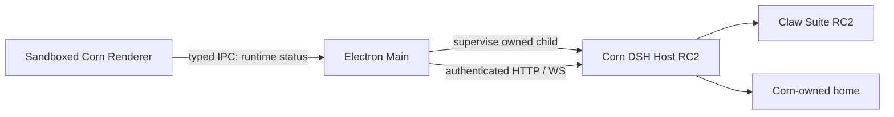

# Corn Bot architecture — M0

Corn is a new application with its own Electron Main, sandboxed Renderer and exact-version DSH Host. It does not launch the installed DSH app or import its profiles, settings or credentials. Development resolves DSH from this repository's dependency graph; the distribution must eventually bundle that graph and Electron's Node runtime.

Main owns the launch-token exchange and private cookie. `HostTransport` implements the pinned official RPC envelope, validates correlation and restricts endpoints. It reuses the official Remote stream parser. No Host URL, cookie, endpoint proxy, SQL, filesystem or model key crosses the current Renderer bridge. The diagnostic window is a small M0 surface; the React product UI belongs to M1.

The supervisor claims only an empty or Corn-marked home, rejects the user's DSH home and aliases, acquires an exclusive process lock, starts an exact-version Host on a dynamic loopback port, bounds readiness and stops its owned child. Concurrent shutdown shares one cleanup operation. DSH's default workspace directory is also redirected into Corn home. Child environment construction drops ambient model credentials and Node injection flags; only explicitly named Corn model configuration enters the child.

DSH remains authoritative for Session logs and Turns. Claw Registry remains authoritative for agent identity and binding. Corn validates `wa_` identity, ensures its preset, creates a Session with that preset and canonical root, and binds it using revision checks. Missing presets and invalid bindings are errors. A successful prompt receipt is admission, not completion. Corn serializes admission per Session and merges duplicate in-flight request IDs. Persistent transaction compensation and Run storage are M2 work.

The stream adapter currently supports opening snapshots and explicit reconnect. It does not yet implement a product event store, automatic recovery policy or approval UI. Transport and SQLite decisions remain proposed until the outstanding M0 checks are complete. See [transport ADR](adr/ADR-0001-dsh-transport.md), [SQLite ADR](adr/ADR-0002-sqlite-runtime.md), [security boundaries](security-boundaries.md) and [M0 evidence](milestones/M0-EVIDENCE.md).
