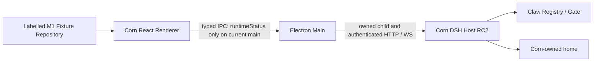

# Corn Bot architecture — current implementation and next boundary

Status checked 2026-10-12 against main `8b6989c`. Current work order and acceptance gates are in the [forward plan](plans/CORN_BOT_FORWARD_PLAN.md). This page describes what is implemented; the plan describes what is next.

Corn owns an Electron Main, sandboxed React Renderer, pinned DSH RC2 Host and Claw Suite RC2. It neither launches the installed DSH app nor imports its profiles, model settings or credentials. The unsigned packaging flow bundles its runtime and verified offline Claw template; signing/notarization and the pending new joint checks are separate acceptance work.

M1 has a product shell, interaction states, fixed runtime strip, static original Corn avatars/icon and management-panel navigation. The normal `CompositionRoot` still chooses `FixtureWorkspaceRepository`: Bot creation/editing, chat sends and approval cards are examples, not real runtime operations. Avatar motion, product event/Run storage and the real Repository are not connected. Global model settings are implemented on paused, unmerged PR #15, not on main.

Main owns authentication, private cookie and child lifetime. `HostTransport` validates the pinned official RPC envelope/correlation and exact endpoint allowlists. The current preload exposes safe runtime status only; it does not expose arbitrary endpoints, Host credentials, SQL or filesystem access. The model-input exception and new narrow commands are planned/implemented in the model branch, with the required review fixes still pending.

The supervisor claims an empty or Corn-marked home, rejects the user's DSH home and aliases, locks the home, bounds startup and supervises its owned child. Current admission composes bundle/profile/home/launcher topology, rejects unverifiable Claw scope changes, checks Registry and Gate after authentication, and rechecks after recovery. Stop has deadlines after TERM and KILL; unconfirmed stop retains ownership/lock and reports a failure rather than starting a replacement. The audit builder tracks its own resources and cancellation. New real lifecycle, GUI, governance and packaged acceptance is still pending; merged code is not a substitute for those checks.

DSH Session logs/Turns remain the current execution facts; Claw Registry owns identities and bindings. Existing adapters and diagnostic integrations establish source/wire behaviour, but they are not yet connected to the product Repository. Receipt acceptance is not completion; requestId, rpcId and Turn are distinct. The intended DB stores product identity/association, delivery records and reconstructable projections, not a second authoritative copy of the full execution history or credentials.

Two DSH boundaries remain important: `session.selectModel` saves the global default asynchronously, so independent Bot/Worker overrides need a verified Session-only seam; cold `session.follow` can activate an Agent, so recovery first reads history/projections and reconciles before following. A Main-only RunControl flag does not automatically guard Host tool dispatch. These are explicit gates for real chat and background work.

The next boundary is a Main-only runtime adapter and real product Repository, followed by a complete single-Worker experience with minimum Run/Attempt/Directive/Completion persistence, dispatch control, resource leases and recovery. DSH Host + Claw is the selected execution runtime ([ADR-0007](adr/ADR-0007-execution-runtime.md), maintainer decision on static evidence); no second Agent Loop is installed. OpenClaw and Mastra stay in [research](research/README.md) and are reconsidered only if ADR-0007 is reopened.

See [transport ADR](adr/ADR-0001-dsh-transport.md), [SQLite candidate ADR](adr/ADR-0002-sqlite-runtime.md), [Claw admission ADR](adr/ADR-0006-claw-admission.md), [execution runtime ADR](adr/ADR-0007-execution-runtime.md), [security boundaries](security-boundaries.md), [M0 evidence](milestones/M0-EVIDENCE.md) and [M1 checklist](milestones/M1-PR-CHECKLIST.md). Historical results retain their own commits and scope.
