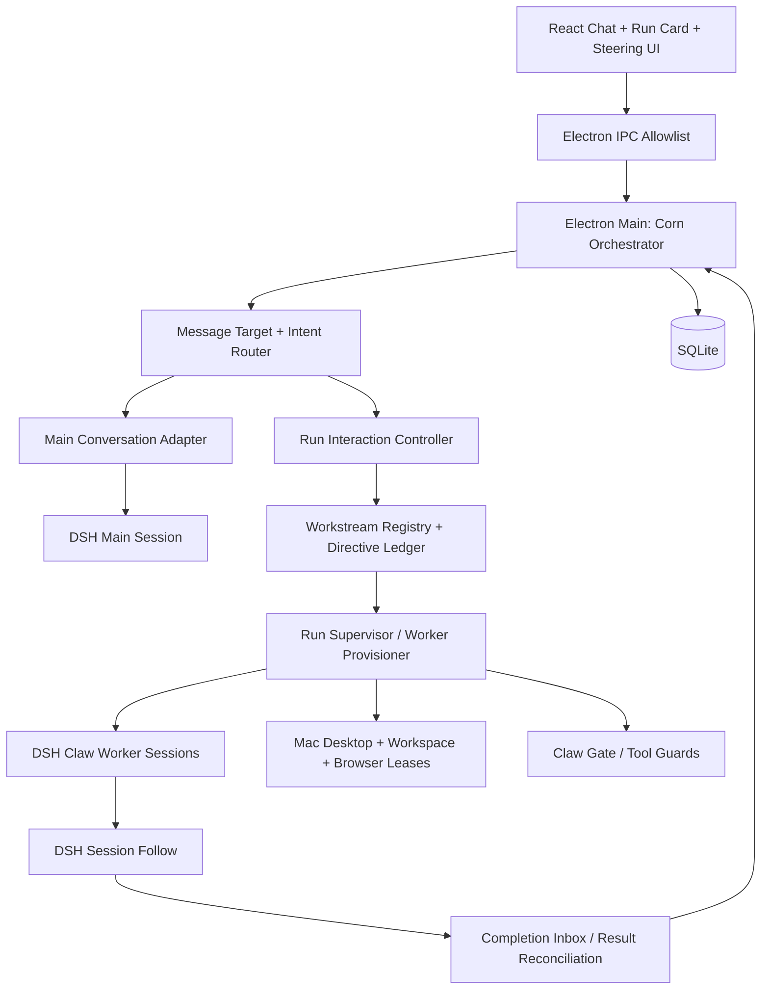

# Corn Bot：Grok Bot 云电脑运行机制深度调查与架构迭代报告

> **报告版本**：2.0（追加验证与 Provider 追踪）· 2026-10-12  
> **研究目标**：解释 Grok Bot 长任务执行期间持续对话、原任务改向、后台委派、控制与恢复的技术线索，转化为 **Corn Bot 可执行的工程方案**。  
> **研究依据**：[grok-bot-runtime-investigation](https://github.com/xingyingyuzhui/grok-bot-runtime-investigation)，原基线 [`1190af2`](https://github.com/xingyingyuzhui/grok-bot-runtime-investigation/commit/1190af2036e8b7963b2e18878d80e2d0b3d70af8) → 本轮固定 [`2133483`](https://github.com/xingyingyuzhui/grok-bot-runtime-investigation/commit/2133483b5f90f079dfb26af4b2993ae12b35cd6d)（增加 4 次提交）；所采集主程序版本标记 `7345aa4`；调查日期为 2026-10-12。  
> **DSH 基线**：[`deepseek-ai/deepseek-harness` `dsh-v0.2.0-rc.2`](https://github.com/deepseek-ai/deepseek-harness/tree/dsh-v0.2.0-rc.2)，固定提交 `639ed015397290b3745d163aafe02ffee4aa3f84`。  
> **定位**：独立专项报告；应与 Corn Bot v1.3 总计划及《后台任务与实时对话并行实施方案》配套，不把研究推断冒充 Grok 服务端已证实事实。  
> **既定约束**：Electron 主进程持有凭据、Renderer 通过受限 IPC（既定 1A，即实际 B 传输拓扑）；保留 DSH Host/Agent Loop/Computer Use 和 Claw 治理；M1 不做 TaskThreadPane；本机 macOS；M2 建立基础持久化与 Run。

---

## 阅读提示：v2.0 相对上版新增的判断

- **有代码且有局部隔离实验**：`SandSteerInbox` 仅在 live run 接收，FIFO 取出；交付失败回队首；结束 Run 时拒绝未交付的注入。但隔离测试并不是云端线上 E2E。
- **两种不同的改向路径**：主执行循环可在安全步骤边界领取新消息；in-process 子代理则可能以 `interrupt()` 结束当前 Turn 后用同一个 Runner 继续任务。前者不等于立即抢占工具，后者不等于销毁任务上下文。
- **发现潜在消息丢失风险**：本地 `pendingSubagentSteers.set(subagentId, message)` 可能在连续插话时覆盖前值；Corn 不照搬，必须持久 FIFO + Revision。
- **发现开关与依赖注入门槛**：MCP 只读提前释放默认关闭；模型空闲采样抢占需要额外 policy；`detachedSubagents` 与 `createCloudAgentTool` 由外部构造注入，找到调用接口不代表找到了线上 Provider。
- **停止边界更加明确**：清除 CloudAgent watch 只停止本地等待/订阅，不一定触达远端取消。不能把“取消监视”显示为“任务已停止”。
- **更新了部署证据**：已检查大量本地文件名、86 个选定静态文件及当前 orbitd 候选服务，仍未找到完整 Temporal Worker。两份现场 bundle 与仓库脱敏后的版本比对一致，但不证明云端实现。

完整新证据与 Corn 落地细节见文末 **§11–§13**。旧 E01–E22 仍是第一轮证据编号；本轮新增资料统一通过本轮 SHA 固定链接引用。

## 0. 执行摘要及决策

**新的核心判断：Corn 不应只实现“一个主 Session + 多个 Worker Session”，还必须加入“对已运行任务的消息介入、等待让出、工作流连续性、结果回传和多资源取消”。**

本次云电脑资料及随后 **4 次追加提交** 对上一版方案的影响。**新增核心修订**：现在可以确认 in-process 收件箱代码的 FIFO 与异常回队首，但也观察到另一条本地子代理改向路径可能因 Map 覆盖丢失中间消息；Corn 应明确采用持久指令日志与顺序采纳。

| 主题 | 上一版理解 | 新证据导致的修正 |
|---|---|---|
| 主 Bot 可用性 | 后台任务放在独立 Worker Session | **继续成立**；新增主 Bot 快速响应、异步委派后不等待、结束自动唤醒的完整产品契约 |
| 用户改向 | 将新消息 steer 到 Worker | 增加 **目标 Worker 复用、待处理步骤边界、等待让出、指令版本与采纳证据**；不保证立即抢占所有工具 |
| Workstream | 每 Run 一条 Worker Session | 区分 **逻辑 Workstream/Run** 与 **DSH Worker Session/Activation**；相关补充优先复用同一执行上下文 |
| 任务队列 | Run Supervisor 独立调度 | 区分用户优先受理、某 Worker 内串行执行、跨 Worker 并发、桌面资源独占；旧 Grok Scheduler 不作为现行算法 |
| 背景完成 | 写入 RunCard 状态 | 增加 **Completion Inbox → Parent Wake → 投递策略 → 已交付**，过滤陈旧/重复/无需通知结果 |
| Stop | 调 `session.cancel` | **逻辑任务层级的取消传播**；先拒绝新副作用，再取消/清理孩子及外部工作，确认终态后才能显示停止成功 |
| 持久 Todo | 只有 Run/RunAttempt | 将 **执行状态** 与 **交付状态** 分离；用户请求先记账再异步委派 |
| Grok 逆向可信性 | 客户端证据 | 这次增加了云电脑侧包内证据，但 Temporal 云端 Worker 仍未取得；新增评估 bundle 与已发现的本机主 Host 并非同一完整执行路径，必须遵守证据分层 |

**建议拍板**：M2 开始做 `RunMessageRouter`、`WorkstreamRegistry`、`RunDirectiveStore` 和 `CompletionInbox`；M3 做安全介入与资源仲裁；M4 做复杂恢复和等待让出。避免为了模拟 Grok 而复制其未获授权的宿主代码。

## 1. 本次研究到底覆盖了什么

### 1.1 采集范围和可信边界

当前固定提交的仓库包含 **134 个 Git Tree 条目**（目录和文件均计入），除约 28.5 MB 的脱敏 `host-main.cjs` 外，还新增约 21.5 MB 的 `sand-eval-runner.cjs`、执行服务分块、守护与监督脚本、Provider 绑定摘录、静态协议摘要和隔离 probe。调查报告记录：当前现场的 17 份代理配置均标为 **`harness = temporal`**，用户消息由云端 RPC 接收，本机负责工具、桌面与存储等支撑；这不意味着本机持有完整云端 Worker。以下按证据强度分层。

| 级别 | 代表证据 | 可以确定的结论 | **不能**推出 |
|---|---|---|---|
| A 当前路径/配置观测 | `运行机制调查.md` §2、[E16–E18](https://github.com/xingyingyuzhui/grok-bot-runtime-investigation/blob/1190af2036e8b7963b2e18878d80e2d0b3d70af8/evidence.txt) | 本实例走 Temporal；用户消息和显式中断是不同 RPC；本机旧 Box 执行发送入口被拒绝 | 已取得 Temporal Worker 调度代码、可证实精确优先级与响应延迟 |
| B 可读的功能契约与内置指导 | E01–E09、E20–E21；提示词与工具定义 | 官方包明确设计了主 Bot 委派、纠正/查询/停止执行者和按需回传 | 本次云端所有 feature gates 已启用，提示词每次都装配成功 |
| C 共享执行引擎实现 | E10–E15 | 存在安全步骤注入、等待释放、Shell 后台化、条件性模型空闲采样抢占实现 | 每条 Grok 文本消息一定直接调用该注入接口；工具均可抢占 |
| D 旧本地执行路径 | E19 与 `run-scheduler.ts` | 代码中存在用户 > Agent > Background 三队列的历史实现 | 这就是当前 Temporal 云端实际 Scheduler |
| E 未取得、未实测 | Temporal Worker、完整 feature gate、真实动态实验 | 必须后续受控试验验证 | 任何确定性的端到端毫秒指标或抢占保证 |

**特别提示**：逆向仓库的源码摘录是研究材料，不是 Corn 产品可直接合并的依赖；即使仓库由用户本人公开，原厂代码及 assets 的知识产权不会自动变成 MIT。报告只描述接口语义和自主实现，不重分发提取源码。

### 1.2 复核索引

本轮增量资料：[SSH 补查](https://github.com/xingyingyuzhui/grok-bot-runtime-investigation/blob/2133483b5f90f079dfb26af4b2993ae12b35cd6d/SSH%E8%A1%A5%E6%9F%A5.md) · [扩大范围调查](https://github.com/xingyingyuzhui/grok-bot-runtime-investigation/blob/2133483b5f90f079dfb26af4b2993ae12b35cd6d/%E6%89%A9%E5%A4%A7%E8%8C%83%E5%9B%B4%E8%B0%83%E6%9F%A5.md) · [接口绑定追踪](https://github.com/xingyingyuzhui/grok-bot-runtime-investigation/blob/2133483b5f90f079dfb26af4b2993ae12b35cd6d/%E6%8E%A5%E5%8F%A3%E7%BB%91%E5%AE%9A%E8%BF%BD%E8%B8%AA.md) · [云端协议快照](https://github.com/xingyingyuzhui/grok-bot-runtime-investigation/blob/2133483b5f90f079dfb26af4b2993ae12b35cd6d/analysis/cloud-routing-protocol.json) · [Provider 映射](https://github.com/xingyingyuzhui/grok-bot-runtime-investigation/blob/2133483b5f90f079dfb26af4b2993ae12b35cd6d/analysis/runtime-provider-map.json) · [隔离 Probe 结果](https://github.com/xingyingyuzhui/grok-bot-runtime-investigation/blob/2133483b5f90f079dfb26af4b2993ae12b35cd6d/analysis/steer_inbox_probe-result.json)。

主入口：[运行机制调查.md](https://github.com/xingyingyuzhui/grok-bot-runtime-investigation/blob/1190af2036e8b7963b2e18878d80e2d0b3d70af8/%E8%BF%90%E8%A1%8C%E6%9C%BA%E5%88%B6%E8%B0%83%E6%9F%A5.md) · [证据 E01–E22](https://github.com/xingyingyuzhui/grok-bot-runtime-investigation/blob/1190af2036e8b7963b2e18878d80e2d0b3d70af8/evidence.txt) · [摘录索引](https://github.com/xingyingyuzhui/grok-bot-runtime-investigation/blob/1190af2036e8b7963b2e18878d80e2d0b3d70af8/excerpts/index.tsv) · [脱敏声明](https://github.com/xingyingyuzhui/grok-bot-runtime-investigation/blob/1190af2036e8b7963b2e18878d80e2d0b3d70af8/SECRET_SCAN.md)。

## 2. 七项影响 Corn 架构的实质性发现

### 2.1 内置委派规则比“多代理并发”更具体（E01、E02、E03）

- 主 Bot 优先处理即时对话与简单查询；多步骤、研究、文件处理、命令链任务倾向委派给通用 `executor`，或者更适合的浏览器/桌面专业执行者。
- 任务下发后主 Bot 不应同步等待或反复轮询；它可以继续处理用户消息或结束当前 Turn，直到结果触发后续处理。
- **相关任务、补充要求、纠正错误**倾向复用同一个执行者，而不是每次创建新的 Agent。包内指导给出“通常一到两个活跃 Executor、四个是软上限”的经验建议；**这是提示词策略，不是实测的平台并发硬上限**。
- 子执行者未必自动看见主聊天全文；下发必须提供目标、必要上下文、约束、成功条件和交付要求。某些 fork 继承行为受开关控制。

**Corn 转化**：创建 `Workstream` 作为“一项持续工作的逻辑身份”，绑定一个当前 Worker Session，允许多轮补充/恢复。RunAttempt 是一次执行，不等于整个 Workstream；同一 Workstream 可跨重试保留任务目标与已提交成果。

### 2.2 “插话优先”与“取消工作”明确分离（E01、E04、E05）

工具分工：[CheckSubagent 摘录](https://github.com/xingyingyuzhui/grok-bot-runtime-investigation/blob/1190af2036e8b7963b2e18878d80e2d0b3d70af8/excerpts/728288-sand-subagent-management-tools.ts.txt) 查询进度、[MessageSubagent] 向正在运行的执行者纠正方向、[StopSubagent] 停止被委派的工作。前两者的结果不是最终执行完成回执。`MessageSubagent` 可能经过专门的 steer 权限检查，再到 detached 或 Host Controller。未证明云端 detached 具体实现。

**Corn 转化**：同一条输入先确认“目标任务”和“意图”，然后选择 `chat`、`run_steer`、`run_status`、`run_stop` 或 `new_run`。不要把普通发送自动升级成 Stop。对于停止指令，用确定性的 `RunControl` 而不是单靠模型自行调用工具。

### 2.3 共享执行引擎确实具备中途注入的安全边界（E10、E11）

接口注释将中途输入定义为到达 **下一可安全处理步骤边界**，不取消已经启动的工作；若注入正好错过运行结束，则落为下一 Turn 的 follow-up；按 injection ID 保证幂等。另一个代码分支在步骤边界领取消息、打上 `turnSteer` 标志、追加至 transcript，并在原会话状态之上创建后续 Turn。

**Corn 转化**：DSH RC2 自身已有 `session.prompt({mode:'steer'})` 和 Agent Inbox，不需复制 Grok 的注入器。必须在 UI 区分：`accepted`（通信受理）→ `claimed`（Agent 领取）→ `adopted`（Worker 确认纳入任务计划）→ `enforced`（后续关键操作由 Gate 验证）；这不是四个等价的成功状态。

### 2.4 快速回应用户依赖“释放阻塞等待”，不仅是多开 Session（E12–E15）

调查证实共享引擎里存在如下行为：等待子代理的调用与新输入信号竞赛，可返回 `stillRunning`，使主 Bot 继续对话；前台 Shell 可以被要求交到后台；在模型尚没有开始可见输出时，可在一定宽限后有条件取消当前采样。它们均有适用边界；例如模型已生成可见输出时，空闲采样抢占会解除。

**Corn 转化**：M2 的 `startRun()` API **只受理并持久化工作，不同步 await 完成**；交给 Supervisor 后立即释放主 Session。若 DSH 内某工具仍会长期阻塞主 Turn，优先改为可查询的后台 Job/Tool 适配器，而不是私自向 DSH Loop 插入未经验证的取消代码。M4 可以增加更精细的 `awaitOrYield`，但不把 Grok 的内部协议直接复制进 Corn。

### 2.5 停止需要父子级联、资源清理以及部分失败报告（E02、E04）

内置停止指导要求处理委派子执行者、相关跨 Bot/云 Agent、后台 Shell，区分已停止、已经结束、失败和不可达。这个策略仍是包内规则，不是对云端每次实际停止行为的保证。

**Corn 转化**：把 `Run.stop()` 设计为编排流程：`stopping` → 拒绝新增副作用 → 申请取消 Agent Turn / 活动工具 → 释放资源租约 → 核对子 Run、Shell、桌面及外部工作 → 确认 `cancelled` 或 `stop_partial`。DSH `session.cancel()` 默认保留 Inbox，不能单凭其 `{accepted:true}` 把整个 Run 标记为已停止。Stop 后不得自动唤醒旧已取消 Workstream。

### 2.6 后台结果并非必须直接发到用户（E07、E08、E09、E21）

后台任务可以产生结果，而决定是否、何时给用户发送的是主 Bot 或明确的通知策略；主 Bot 会被唤醒检查内容是否新颖、相关、重复、陈旧，以及用户是否在等待。自动化存在专门的父级唤醒工具。`TodoWrite` 的状态语义强调，结果已计算出来和**结果已经交付**是不同里程碑。

**Corn 转化**：引入 `CompletionInbox` 与 `DeliveryReceipt`。Run 完成后先形成不可变结果候选，再判断：等待用户的结果需要可见通知；静默 Routine 可保留记录但不打断；过期、重复或已取消结果不能自动改变当前聊天；外部发送必须独立授权。不要在 Worker 报告“完成”时就自动假造一次主 Bot 消息。

### 2.7 用户和 Agent 消息优先级存在多层概念（E06、E19、E20）

- 面向另一个 Bot 的 `SendToAgent` 有优先消息和仅供下次读取的信息消息之分，它不等同于同一执行者的用户 steer；跨环境/群聊有限制。
- 旧 `SandRunScheduler` 按用户、Agent、Background 队列取任务，但对应本地路径已退役；**不能宣称当前 Temporal 采用这套三队列**。
- CloudAgent `queue/steer/interrupt` 有 feature gate 和 Temporal-only 注释，仓库里的默认值 `false` 也不等于用户账号真实运行值。

**Corn 转化**：按 `control/interactive/background` 设 **Corn 自主资源优先级**，不声称这就是 Grok 算法；每个 DSH Session 的 Agent Inbox 仍遵守 DSH 现有排序与所有权机制。资源优先处理不等于能立即抢占已提交的工具调用。

## 3. 与 DeepSeek Harness RC2 的逐项对照

| Grok 发现 / 意图 | DSH RC2 可复用的实现 | Corn 必须新增的部分 | 关键风险 |
|---|---|---|---|
| 用户随时发消息 | `SessionController.prompt` / `queue` / `steer` | IPC 受理、工作目标路由、独立主 Session | 目标 Session 忙碌时 `queue` 不能即时回答 |
| 用户修订当前工作 | `agent.steer()`；continuable child 的 message delivery | Run 指令账本、采用检查点、Scope/Gate 更新 | `accepted` ≠ `adopted`；steer best effort |
| 委派 Executor | DSH Agent Loop + Subagent Runtime；普通 Claw Session | RunSupervisor、Worker Provisioner、workstream 复用策略 | 子代理 API 所有权与 Claw Session 绑定语义不能混淆 |
| 已有执行者持续上下文 | DSH durable Session / continuable child | workstream→session 映射、checkpoint/retry / resume | Worker 持久 Session 不保证原工具进程永远存活 |
| 主 Bot 可即时聊天 | 独立主 Session，异步后台 Session | 快速返回 `runId`，主 Session 不 await Worker | 共享模型 provider、本机资源仍可能排队 |
| 获取进度与自动唤醒 | `session.follow`、history snapshots、subagent Catalog | CompletionInbox、状态查询、主 Bot Wake 策略 | stream partial frames ≠ 可靠完成记录 |
| 停止任务 | `session.cancel({keepInbox:true})`、某些 Subagent interrupt | 级联停止、scope closure、工具资源回收、部分失败报告 | 当前执行的外部动作未必可回滚 |
| 工具强约束 | DSH `tools/pre-execute` / `tools.guard` + Claw Gate | revision-aware 策略检查、租约与 fencing | 只用 steer 文本不足以强制禁止危险操作 |
| 回复关联 / 去重 | DSH `requestId`、Inbox events、`session.follow.seq` | Corn 消息幂等键、Run 事件、reducer、客户端送达层 | 重连重复片段、发送中网络未知态 |

**DSH 精确参照**：

- [Session types](https://github.com/deepseek-ai/deepseek-harness/blob/dsh-v0.2.0-rc.2/packages/api/session-controller/src/types.ts) `SessionPromptRequest` / `SessionPromptValue`；
- [Session commands](https://github.com/deepseek-ai/deepseek-harness/blob/dsh-v0.2.0-rc.2/packages/api/session-controller/src/commands.ts) `prompt`：`steer→agent.steer`，`queue→agent.followup`，返回只说明受理；`cancel` 保留未领取 Inbox；
- [Session history](https://github.com/deepseek-ai/deepseek-harness/blob/dsh-v0.2.0-rc.2/packages/api/session-controller/src/history.ts) `follow`：snapshot、严格 seq、assistant-stream；
- [Subagent design](https://github.com/deepseek-ai/deepseek-harness/blob/dsh-v0.2.0-rc.2/docs/subsystems/subagent.md) continuable child：durable child Session、单 Activation、父子权限与 cold-resume、owner 取消限制；
- [Tool execution pipeline](https://github.com/deepseek-ai/deepseek-harness/blob/dsh-v0.2.0-rc.2/docs/tool-execution-pipeline.md) 工具审批和单调 Guard。

**架构选择**：M2 最小版本继续采用 **合法 Claw Registry 绑定的普通 DSH Worker Session**（每个当前活动 Workstream 一个），由 Corn Orchestrator 建立后台执行和方向管理。M4 可验证内置 `startContinuable` 的真实可用性与权限适配后替换；不要把该 API 当作 Renderer 可任意直接调用的公开 Session 创建方式。无需复制 Grok 的三队列 Scheduler、RPC 协议或提示词原文。

## 4. Corn 建议目标架构



**四个身份必须分开**：

| 对象 | 身份字段 | 生命周期 |
|---|---|---|
| Bot | `botId`，合法 Claw `agentId` | 持久角色、记忆、工具权限 |
| 主对话 | `conversationId`, `mainDshSessionId` | 用户可见的聊天历史，默认一条 |
| Workstream/Run | `workstreamId`, `runId`, `runAttemptId` | 某项用户目标、执行阶段、控制和产物 |
| Worker | `workerDshSessionId`, `workerGeneration` | DSH 活跃执行上下文，重建或换代不改变 Workstream |

不同 Worker 不应直接获取整个 Bot 的全部私有数据，而要按 Claw Identity、Policy、Memory 和最小必要上下文获得授权。主 Session 也不要持续吸收 Worker 的完整工具日志。

### 4.1 同一 Bot 新消息的路由决策表

| 用户消息与明确目标 | Corn 路由 | 可靠性要求 |
|---|---|---|
| 无指定任务的闲聊 | 主 Session，`queue` | 后台 Run 不受影响，保留当前草稿 |
| 指定 Run 的补充/纠正/回答澄清 | 当前 Worker 的 `steer` | 持久化 directive，确认目标/版本，不发错 Bot |
| 指定 Run 的状态询问 | 直接查 Corn Run/进度 | 不要为每个“到哪了”启动模型或轮询长工具 |
| 取消某一 Run | `stopRun(runId)` | 显示 stopping，核验 Worker/资源终态 |
| 取消该 Bot 所有工作 | 按 Bot 查询活动 Run，作用域级联 Stop | 列出成功与未知状态，不暗中停止其他 Bot |
| 独立新工作 | 新 Workstream/Run | 容量不足明确显示 queued，而非假称 running |
| 意图不明、多个活动 Run | 先询问目标或提供选择 | 不把修改“猜”给错误执行者 |

**优先显式作用域**：回复 RunCard、任务详情中的输入天然包含 `runId`；从主聊天发送时由用户选择、会话最近目标或可解释分类器辅助判断，不允许模糊模型分类自动触发高风险动作。`replyToId` 和任务 ID 分别持久化，不复用客户端当前选中行冒充服务端地址。

### 4.2 状态按三个维度展示

**消息交付** `draft / local-queued / submitting / host-accepted / claimed / send-failed`；
**任务指令** `pending-adoption / adopted / superseded / rejected`；
**工作执行** `queued / starting / running / waiting / stopping / completed / failed / cancelled / stop-partial / unknown-after-restart`。

`host-accepted` 只能显示“已送达”；`claimed` 只能显示“执行者已领取”；只有带来源的应用层检查点才可显示“已纳入任务计划”。`completed` 与 `delivered-to-user` 是两件事。

## 5. 代码级域模型与 API（Corn 自主设计，不是 Grok/DSH 原生 API）

```ts
export type MessageTarget =
  | { kind: 'main'; botId: string; conversationId: string }
  | { kind: 'run'; botId: string; conversationId: string; runId: string };

export type RunDirectiveKind = 'constraint' | 'correction' | 'clarification' | 'stop';

export interface RunDirective {
  directiveId: string;         // 客户端提交前已生成并持久化
  runId: string;
  botId: string;
  authorMessageId: string;
  revision: number;            // 同一 Run 内严格递增
  kind: RunDirectiveKind;
  content: string;
  status: 'pending' | 'accepted' | 'claimed' | 'adopted' | 'rejected';
  dsRequestId?: string;
  receivedAt: string;
  adoptedCheckpointId?: string;
}

export interface WorkstreamState {
  workstreamId: string;
  botId: string;
  activeRunId: string | null;
  activeWorkerSessionId: string | null;
  desiredRevision: number;
  adoptedRevision: number;
  stopEpoch: number;            // Stop 后拒绝旧 Worker 与工具回放
}

export interface WorkerCheckpoint {
  checkpointId: string;
  runId: string;
  workerSessionId: string;
  observedRevision: number;
  stage: 'plan-updated' | 'before-side-effect' | 'result-committed';
  sourceSeq?: number;
  createdAt: string;
}
```

`RunDirective.status='adopted'` **绝对不能**只因为 DSH `prompt` 返回 accepted 而写入。至少需要 Worker 产生带 `directiveId/revision` 的受控确认事件；如果上游暂时无法提供这一事件，UI 保持 pending/claimed，不伪造采纳确认。确定性禁止操作由 Claw Gate 的有效策略执行，不依赖语言模型“理解了”这一承诺。

### 5.1 发送接口与目标校验

```ts
interface CornMessageEnvelope {
  clientMessageId: string;
  botId: string;
  conversationId: string;
  target: MessageTarget;
  replyToId?: string;
  content: string;
}

async function handleMessage(msg: CornMessageEnvelope) {
  // 所有映射从 SQLite 读取，不相信 Renderer 传来的 sessionId
  const target = await resolveAuthorizedTarget(msg);
  await persistIncomingOnce(msg);  // UNIQUE(botId, clientMessageId)
  if (target.kind === 'main') return mainSession.enqueue(msg);
  return runInteraction.dispatch(target.runId, msg);
}
```

### 5.2 不阻塞前台的长任务受理

```ts
async function startBackgroundWork(request: StartWorkRequest) {
  const work = await db.createWorkstreamAndRunOnce(request);
  supervisor.enqueue(work.runId);  // 仅安排处理，不 await Worker 的全部执行
  return { runId: work.runId, state: 'queued' as const };
}

async function provisionAndStart(runId: string) {
  const run = await db.claimQueuedRun(runId);
  const sessionId = await clawBindingTransaction.createBoundSession(run.botId);
  await db.bindWorker(runId, sessionId);
  await dsh.session.prompt({
    requestId: stablePromptId(runId, 'initial'),
    sessionId,
    mode: 'queue',
    content: [{ type: 'text', text: buildMinimumNecessaryTaskPrompt(run) }],
  });
  // accepted 仅表示进入 Inbox，后续运行状态由 follow/事件确定
}
```

### 5.3 任务运行中改向：先持久化，再 steer，再确认

```ts
async function steerExistingRun(runId: string, message: CornMessageEnvelope) {
  const directive = await db.appendDirectiveOnce(runId, message); // 原子分配 revision
  await enforceImmediateLocalRestrictions(directive); // 仅适用于可确定性表达的限制
  const sessionId = await db.activeWorkerSession(runId);
  await dsh.session.prompt({
    requestId: directive.dsRequestId ?? stablePromptId(runId, directive.directiveId),
    sessionId,
    mode: 'steer',
    content: [{ type: 'text', text: formatScopedDirective(directive) }],
  });
  await db.markDirectiveAccepted(directive.directiveId);
  // 注意：此处不可写 adoptedRevision = directive.revision
}
```

出现“当前 Turn 已结束”的竞争时，不自行声称 `steer` 总能回退为下一 Turn；DSH RC2 的精确行为需以实测校验。必要时 Corn 在收到可识别的拒绝后用**同一稳定意图、明确队列去重策略**补发 `queue`，避免重复执行；不支持可靠判别时标为 `delivery-uncertain` 并等待事件对账，不能盲目重发。

### 5.4 任务停止：操作收敛而非瞬间成功

```ts
async function stopRun(runId: string): Promise<StopResult> {
  const stop = await db.beginStopIfNeeded(runId); // 幂等 stopEpoch + state=stopping
  await runGate.closeForNewSideEffects(runId, stop.stopEpoch);
  await supervisor.requestCancelWorker(runId); // 底层 DSH cancel 或获授权 subagent interrupt
  await resourceArbiter.releaseWhenQuiescent(runId);
  const outcome = await reconciler.verifyQuiescence(runId);
  return await db.settleStopOutcome(runId, outcome); // cancelled / stop_partial / unknown
}
```

关键：**先阻止未来副作用、再要求中止、最后核验完成**。对已经发生的文件变更、外部消息或键鼠动作要显示事实，不承诺自动回滚。`session.cancel(keepInbox:true)` 的残余 Inbox 必须通过取消代际或会话隔离处理，不能在后续激活时使已停 Run 恢复工作。

## 6. SQLite 设计与可靠事件语义

在 M2 基础 Migration 之上增量建立，不覆盖现有 `0001`：

```sql
CREATE TABLE IF NOT EXISTS corn_workstreams (
  workstream_id TEXT PRIMARY KEY,
  bot_id TEXT NOT NULL,
  active_run_id TEXT,
  active_worker_session_id TEXT,
  desired_revision INTEGER NOT NULL DEFAULT 0,
  adopted_revision INTEGER NOT NULL DEFAULT 0,
  stop_epoch INTEGER NOT NULL DEFAULT 0,
  CHECK(adopted_revision <= desired_revision)
);
CREATE TABLE IF NOT EXISTS corn_run_directives (
  directive_id TEXT PRIMARY KEY,
  run_id TEXT NOT NULL,
  bot_id TEXT NOT NULL,
  client_message_id TEXT NOT NULL,
  revision INTEGER NOT NULL,
  delivery_status TEXT NOT NULL,
  adoption_status TEXT NOT NULL,
  dsh_request_id TEXT,
  adopted_checkpoint_id TEXT,
  UNIQUE(run_id, revision),
  UNIQUE(bot_id, client_message_id)
);
CREATE TABLE IF NOT EXISTS corn_completion_inbox (
  completion_id TEXT PRIMARY KEY,
  run_id TEXT NOT NULL,
  worker_generation INTEGER NOT NULL,
  result_revision INTEGER NOT NULL,
  delivery_policy TEXT NOT NULL,
  delivery_state TEXT NOT NULL,
  source_event_key TEXT NOT NULL UNIQUE
);
CREATE TABLE IF NOT EXISTS corn_session_follow_cursors (
  dsh_session_id TEXT PRIMARY KEY,
  last_committed_seq INTEGER NOT NULL DEFAULT -1
);
```

迁移之前先探查现有 `corn_task_runs`、`corn_events`、`corn_run_attempts`，与现有表和外键合并；本节是约束示例，而不是不经审查即可执行的最终 SQL。`desiredRevision` 的增长和事件插入需在同一事务内完成。`follow` 持久 seq 去重（`(session_id,seq)` 唯一），assistant stream 只是临时展现，不重复落为最终持久消息。来自完成事件的 `resultRevision` 必须和当前任务目标/停止代际核对。

### 6.1 Completion Inbox 的投递判定

- `run.status=completed`：只说明后台执行已产生终态或成果。
- `completion.state=ready`：完成包经过去重与版本核验；仍未必已告诉用户。
- `delivery_policy=notify_user`：在主 Bot 空闲/可协调时投递一次，收到用户可见记录回执才标 `delivered`。
- `delivery_policy=silent`：定时静默任务保留 Artifact 与审计，不强制唤醒。
- `run.cancelled`、较旧 `workerGeneration/stopEpoch` 或冲突 `resultRevision`：记为 `suppressed_stale` 并保留可追溯记录，必要时按特定非冲突结果合并，而非无条件丢掉全部数据。
- 如需发往邮件、第三方 Bot 或其他账户，须单独通过 Claw Permissions/Gate，Completion Inbox 绝不意味着外发已被授权。

## 7. 本地 macOS 的并发、阻塞与安全

**共享推理与工具不是免费并发**。应把 `foreground-chat`、`user-control`、`background-worker` 分别限流；为前台预留可用容量，而不向用户保证 0 延迟。

- `DesktopControlLease`：当前物理 Mac 桌面只允许一个控制写入者，带 fencing token、TTL/heartbeat、用户人工接管开关。DSH CUA Provider 负责操作，但不代表已提供跨 Run 互斥。
- `WorkspaceWriteLease`：相同仓库的多个 Run 使用独立 Git Worktree，或独占写锁；重试不直接覆盖新的用户改动。
- `BrowserProfileLease`：不同自动化 Run 隔离浏览器上下文；与用户真实浏览器联用时必须获明确授权。
- **工具执行前二次检查**：每次副作用开始前核验 Run 未停止、worker generation、directive revision 与当前 Claw Policy/Gate；不可依靠模型主观理解。
- `Stop` 优先级高于所有新工具请求。停止尚在进行时，如果外部系统无法确认终止，就报告 `stop_partial/unknown` 而不是“已停止”。
- 开发/调试时隔离 DSH_HOME，绝不改写用户现有 Claw Profile。

## 8. 对 Corn Bot 实施顺序的增量修改

保留已经选定的 M0–M8，且遵守“仅在 M1 完成两张截图与动态头像，M1 不做复杂 TaskThreadPane；M1 可并行开发不触碰 UI 的 M2 基础”的决策。

| PR 建议名称 | 阶段 | 主要文件与交付 | 必须验收 |
|---|---|---|---|
| `PR-RUN-01` Message Target & Workstream | M2 | `packages/contracts/src/{message-target,workstream}.ts`，`services/corn-orchestrator/src/message-target-router.ts`，SQLite 增量 Migration | RunCard reply → 正确 Worker；主聊天 → 主 Session；歧义不误路由 |
| `PR-RUN-02` Durable Director & Steer | M2–M3 | `run-directive-store.ts`、`run-interaction-controller.ts`、`packages/dsh-adapter/src/session-steering.ts` | 连续指令有序、去重；`accepted` 不伪装 `adopted`；当前 Turn 结束竞态 |
| `PR-RUN-03` Detached Execution / Completion | M3–M4 | `run-supervisor.ts`、`completion-inbox.ts`、`main-session-wake.ts` | 主聊天不 await；后台结果完成只通知一次；旧结果不覆盖新方向 |
| `PR-RUN-04` Hierarchical Stop & Gate | M3 | `run-control.ts`、`run-resource-arbiter.ts`、Gate 集成及 Stop 结果投影 | 停止回执与终态分离；部分失败可见；Stop 后不继续调用危险工具 |
| `PR-RUN-05` Yield / Recovery / Observability | M4 | `run-reconciler.ts`、`run-follow-recovery.ts`、`run-scheduler-metrics.ts` | 断网、Host 崩溃、运行期间插话、重试、落盘事件去重；性能指标 |

**代码路径说明**：以上是按 v1.3 设计包推导的模块建议，尚未逐文件对照当前 `corn-bot` 仓库 HEAD；执行 Agent 需先 `git ls-files` 检查实际包层级、迁移编号、已存在的 RunSupervisor，避免重复建表、重复调度或绕开已完成的 ADR。

### 8.1 推荐 E2E 验收矩阵

| ID | 场景 | 必须观察的事实 |
|---|---|---|
| RT-01 | Run 正在执行 60 秒长任务，用户问无关问题 | 主 Session 独立作答；Worker 继续，且没有无条件被取消 |
| RT-02 | Run 修改文件前，用户插话“不要改数据库” | 先记录修订；工具执行前策略阻止后续数据库写入；不能只凭 prompt ACK 过测 |
| RT-03 | 同一 Run 100ms 内连续三条约束 | revision 严格递增，Worker 最终版本正确，无丢失/乱序；若重试则单次处理 |
| RT-04 | steer 正好碰上 Worker 完成 | 指令进入可观测的采用或待处理/恢复态，绝不假显示已采纳或被静默丢弃 |
| RT-05 | Worker 完成后两次推送相同结果 | CompletionInbox 去重；用户只收到一次成果通知 |
| RT-06 | 用户明确 Stop，Worker 有活跃工具和排队工作 | `stopping` 先显示；禁止新副作用；确认后才 `cancelled`，失败显示未完全停止 |
| RT-07 | Run A 旧结果晚于 Run B 新方向返回 | 旧 Worker generation/revision 无法覆盖当前 Run 状态，但日志与合法 Artifact 保留 |
| RT-08 | 主会话异常退出，但后台 Run 仍在工作 | 状态可恢复；不把断线视为完成；不重复启动已经受理的 Run |
| RT-09 | 两个 Run 同时要求操作 Mac 桌面 | 仅一方获得 Desktop Lease，另一方排队，手动接管后双方停止自动桌面写入 |
| RT-10 | 给 Bot B 的任务卡回复，期间切换到 Bot A | 服务端验证 botId/runId/Session mapping，无跨 Bot 注入 |
| RT-11 | 静默 Routine 完成，无新变化 | 不打扰用户；有可追溯审计与成果记录 |
| RT-12 | 长时间等待 Worker 时收到新消息 | 主对话不被等待锁住；能查询 `still running`；原 Worker 不被误结束 |

## 9. 风险与未决试验

| 优先级 | 风险/未知项 | 验证行动 |
|---|---|---|
| P0 | Temporal Worker 调度源码未取得；无法确认 Grok 所有消息的实时抢占机制 | 不声称线上队列细节。以已取到的契约和 DSH 自身实现做 Corn，必要时对 Grok 做用户自有账号的受控黑盒观察 |
| P0 | DSH continuable child 的所有权限制与 Claw Registry 绑定之间可能冲突 | M0/M2 做集成测试；首版先用受控的 Claw 顶层 Worker Session |
| P0 | 执行器“采用新版本”的自动可信证明缺失 | 设计带 revision 的 Corn ToolGate/checkpoint；不在纯模型自然语言声称下提高状态 |
| P0 | Stop 发出后，原 DSH Inbox 可能保留后续消息 | 明确 stopEpoch、Session 隔离、清理受控队列和副作用拒绝，验证重启后不会继续旧 Run |
| P1 | 服务端拒绝或未知网络状态导致消息重复 | SQLite 幂等 + DSH requestId + 事件回执；不确定时先对账再重试 |
| P1 | Grok prompt 中的经验并发数量不是可证明的适合 Corn 的容量 | 基于本机模型、远端速率、CPU/GPU 和桌面资源进行基准测试 |
| P1 | Grok 旧本地 Scheduler 与 Temporal 代码混淆 | 来源矩阵和 ADR 显式标记“retired/legacy-only”，禁止把它搬入 Corn |
| P1 | 用户公开仓库含 28.5 MB 第三方打包代码，即便做过 token 脱敏 | 审核 GitHub 仓库可见性、原代码授权、历史提交及二次秘密扫描；必要时保留私有分析材料，只公开自主结论 |
| P2 | 语音用户插话与后台任务控制混淆 | TTS truncation、STT input、Run stop 三个独立状态；语音阶段另立验收，不混入 M2 |

**合规/安全说明**：仓库 `SECRET_SCAN.md` 报告两处值已脱敏，但静态模式检查不能证明所有潜在凭据完全不存在，也不能证明公开托管原打包程序被授权。不要在 Corn 代码仓库复制 `host-main.cjs`、原始专有 prompt 或未知许可证的算法组件。对外发报告亦尽量引用文件位置、语义和少量必要标识，避免贴出大段第三方源码。

## 10. 对原有方案的最终修订结论

1. **保留**：持久 Bot、前台主 Session、后台 Worker Session、Run ID、独立状态、Claw Gate、Mac 桌面租约、Electron Main 持密钥。
2. **强化**：相关工作优先复用同一 Executor；建立 Workstream/Directive Ledger；Run 修改需明确作用域和执行检查点；Worker 完成先进入 Completion Inbox。
3. **新增**：主 Session 不阻塞等待、等待者让出/事件唤醒、停止级联和部分失败报告、Run 执行与结果交付状态分离。
4. **不照搬**：Grok 内部旧 Scheduler、Temporal RPC、专有源码、未实际验证的云端内部抢占机制。
5. **交付判断**：Corn M2 达到“任务启动后继续聊天、能 steer 原 Worker、消息状态真实”；M3 达到“工具 Gate 强约束与可靠停止”；M4 达到“重启/失联恢复、结果过滤、工作流自动唤醒”，才算具备 Grok Bot 式连续协作的核心体验。

---

### 可复制给 Coding Agent 的实施要求

> 先阅读本报告、既有 Corn 总计划与 `ADR-0001`/SQLite ADR，以及 DSH RC2 源码。将 Grok 本次研究标记为“当前 Temporal 路由事实 / 内置契约 / 共享引擎实现 / 旧本地代码 / 尚未验证”五类，**不得复制原厂源码**。先审核 Corn 当前代码和迁移，再分别落实 `WorkstreamRegistry`、`RunDirectiveStore`、`RunInteractionController`、`CompletionInbox`、`RunStopCoordinator`。所有消息保留 botId/conversationId/runId/clientMessageId；每个阶段必须有端到端可复现实验，并提供文件位置、版本 SHA、测试日志、行为录屏或截图。不得以 `accepted:true` 冒充任务已改向，以 `cancel.accepted` 冒充所有工具已停止，或绕开 Claw Gate 直接调用 Mac CUA。


---

## 11. 第二轮新增的代码事实与可信边界（Git HEAD `2133483`）

### 11.1 数据包、时间线与证据分类

**增量范围**：自初版 `1190af2` 至 `2133483` 共 4 次提交，新增 `sand-eval-runner.cjs`（评估 runner）、执行服务 `exec-daemon` JS bundle/分块、Supervisor/启动脚本、`SSH补查.md`、`扩大范围调查.md`、`接口绑定追踪.md`、多个 `analysis/*.json` 和经过行号定位的摘录文件。当前采集材料仍没有完整的线上 Temporal Workflow / Activity 代码。

| 结论 | 证据等级 | 当前可确认 | 尚不可声称 |
|---|---|---|---|
| 主机消息 RPC 接收用户输入 | 当前 Host 客户端源码 | `sendGrokBotUserMessage` 接收 `agentId/messageId/sessionId?/taskId?`，送达结果含 `ACCEPTED_TEMPORAL/DUPLICATE/REFUSED` | 云端必定立即调用 steer |
| 容器内使用 Temporal 配置 | 现场配置归纳 | 此轮检查的 17 份代理配置标为 `temporal` | 已得到完整的云端 Temporal Worker 调度器 |
| `SandSteerInbox` 消费规则 | eval bundle 静态源码 + 仓库记录的隔离 probe | 活动 Run 门禁、顺序消费、出错回队首、Run 结束拒收/结算 | 当前线上每条消息都经过此 Inbox |
| in-process 子代理插话 | eval bundle 实现 | pending steer、interrupt 当前回合、复用 Runner 继续 | 云端 detached Provider 采用相同算法 |
| MCP 让出、模型抢占 | 共享 eval bundle | 两者有可用代码和特定开关/安全限制 | 默认开启，所有工具可立即取消 |
| `SandRunScheduler` 优先级 | 旧本地调度源码 | user > agent > background 的旧选择顺序 | 线上 Temporal 仍用这套 Scheduler |
| orbitd | 现场接口枚举和选定字符串检查 | 与截图/捕获、操作记录有关的服务接口 | orbitd 是 Bot 的 Temporal Workflow Worker |

**证据标签建议**：`runtime-observed`（现场配置/接口元数据）、`source-confirmed`（静态代码）、`isolated-validated`（在隔离环境复核的片段）、`provider-unverified`（接口实现未取得）、`historical`（旧路径）、`proposal`（Corn 自行设计）。所有交付给 Coding Agent 的技术判断都必须带标签。

### 11.2 端到端真实 RPC 与 Agent 注入接口不能混同

从 [cloud-routing-protocol.json](https://github.com/xingyingyuzhui/grok-bot-runtime-investigation/blob/2133483b5f90f079dfb26af4b2993ae12b35cd6d/analysis/cloud-routing-protocol.json) 能看到，客户端 `SendGrokBotUserMessageRequest` 有 `agent_id`、`message_id`、`session_id` 和 `task_id` 等字段，**没有直接指定 `steer/queue/interrupt` 的请求字段**。其响应类型另有 `dispatched`、`mode`、`workflow_id`、`delivery` 和 `refusal` 等字段。

其含义是：客户端负责送入带上下文的消息，云端选择怎样处理；服务端返回的模式/Workflow 信息不等于客户端控制了当前模型执行步骤。明确停止通过另一个 RPC `InterruptGrokBotAgentRun` 完成。这直接支持 Corn 的 **单一输入框 + 显式目标 + 服务端协调路由**，不支持“收到用户消息直接 kill Worker”的错误实现。

**对 Corn 的决策**：Renderer 通过受限 IPC 发送携带 `botId/conversationId/runId?/replyToId?/messageId` 的信封；Corn Main 负责目标校验、幂等、发送策略和对应 DSH Session 的解析，不能将用户输入直通任意 `sessionId`。

### 11.3 `SandSteerInbox` 的确切语义及其局限

[turn-steer.ts 摘录](https://github.com/xingyingyuzhui/grok-bot-runtime-investigation/blob/2133483b5f90f079dfb26af4b2993ae12b35cd6d/excerpts/eval-564631-turn-steer.ts.txt) 表明该 in-process 收件箱使用 `pending[]`：

1. `beginRun()` 才接受注入；无活动 Run 返回 `no-live-run`。
2. `enqueue()` 把 `userMessageAction` 入队，并通知 `onUserInjectionAdmitted` 订阅者。
3. `peek()` / `pop()` 从队首读取；`pop()` 把项目移动到 `poppedAwaitingTurn`。
4. 新 Turn 处理失败时，`failConsumedInjectionDelivery()` 可将已取出项 `unshift` 回队首。
5. `endRun()` 把剩余待交付内容判为 `false`；调用者必须另行决策 follow-up / retry，不能静默丢弃。

仓库的 [steer_inbox_probe.cjs](https://github.com/xingyingyuzhui/grok-bot-runtime-investigation/blob/2133483b5f90f079dfb26af4b2993ae12b35cd6d/analysis/steer_inbox_probe.cjs) 在隔离环境用协议类 stub 测试以上行为，记录 `passed`。**本报告审阅了测试脚本和结果记录，但没有独立在 Grok 在线环境执行测试。**

`deliveredAtStepBoundary: true` 说明注入被此代码路径消费，**不等于**“已经纳入任务计划”或“未来的副作用一定符合新指令”。安全约束必须由 Corn 自己的 DirectiveStore / Claw Gate 机制保证。

### 11.4 同为“插话”，有两种执行策略

| 类型 | 代码动作 | 对已有工作的影响 | Corn 对应设计 |
|---|---|---|---|
| **安全步骤注入** | 注入队列 → `consumeQueuedUserMessagesAndMaybeCreateNewTurns()` → 新 `AgentTurn` / `turnSteer` | 原执行循环状态保持；当前不可安全取消的工具可以先返回 | 继续优先使用 DSH RC2 `session.prompt(mode:'steer')` |
| **in-process 子代理纠正** | `pendingSubagentSteers.set()` → `runner.interrupt()` → 当前 Turn settled 后重新 `runSandAgentTurn()` | 当前 Turn 可能被打断，但复用原 Runner 与上下文 | Worker 级 cancel/restart 只作为显式受控的第二策略；不得视为所有 `steer` 的定义 |

在 [subagent-runtime.ts 摘录](https://github.com/xingyingyuzhui/grok-bot-runtime-investigation/blob/2133483b5f90f079dfb26af4b2993ae12b35cd6d/excerpts/eval-526093-subagent-runtime.ts.txt) 中，`pendingSubagentSteers` 是以子代理 ID 为键的 Map。多个改向内容如果在本轮结算前到达，后一次 `set()` 可能覆盖前一次；其确切效果只对该 in-process 实现成立。**不要把这个行为当成 Grok 云端的最终设计。**

**Corn 必须改进**：用数据库保存每条 Directive 的完整内容、递增 Revision、顺序、发送/领取/采纳状态。可对多个相容更新生成综合提示，但必须保证各条原始约束不丢失，并记录每条消息的采纳关系。不可仅保存一个 `pendingSteer: string`。

### 11.5 提前让出的条件，及为什么它不是“全工具抢占”

| 类别 | 触发条件 | 共享代码行为 | 对 Corn 的建议 |
|---|---|---|---|
| 子代理 Await | 等待期间收到消息信号 | 结束这一次 Await，返回 `stillRunning`；子代理仍工作 | Corn `RunSupervisor` 不得在主对话里同步等待子执行者 |
| 前台 Shell / 子代理工具 | 已具备注入信号和后台化执行器 | 请求移交到后台；失败时可重试 | 将长时间工具包装为可持久查询的 Job，记录 Job ID |
| MCP read-only | `steerReleaseReadOnlyTools=true`、工具宣称 `readOnlyHint=true`、存在注入信号 | 可在最短等待后请求取消并释放当前 Await | **Corn 默认不启用自动 MCP 释放**；先做 allowlist/副作用审计 |
| 模型空闲采样 | 提供 `idleModelSamplePreemption` policy，尚未出现可见正文/工具输出 | 可在宽限期后取消闲置采样 | 优先前台资源预算；不依赖任意模型请求强制抢占 |

[read-only MCP 摘录](https://github.com/xingyingyuzhui/grok-bot-runtime-investigation/blob/2133483b5f90f079dfb26af4b2993ae12b35cd6d/excerpts/deep-eval-446569-mcp-steer-release.txt) 的默认值为 `steerReleaseReadOnlyTools=false`、最短执行 5000 ms、取消后等待 drain 1500 ms；这 **不是生产端强制 SLA**。工具的 `readOnlyHint` 是提供者声明，并不保证工具真的无副作用。延迟返回的结果被丢弃也不表示外部操作回滚。

[模型采样抢占](https://github.com/xingyingyuzhui/grok-bot-runtime-investigation/blob/2133483b5f90f079dfb26af4b2993ae12b35cd6d/excerpts/deep-eval-458711-idle-preemption.txt) 必须有额外 policy，评估 runner 的 Inbox 默认只暴露 admission signal，没有自动附加该策略。无实际策略就不能声称新消息一到便中断模型推理。

### 11.6 Provider 绑定、评估开关与线上 Temporal 的真正缺口

[运行时 Provider 映射](https://github.com/xingyingyuzhui/grok-bot-runtime-investigation/blob/2133483b5f90f079dfb26af4b2993ae12b35cd6d/analysis/runtime-provider-map.json) 记录：

- **eval bundle** 能定位到 `SandAgentRunner`、`SandSteerInbox`、`createSubagentRuntime` 的命名实现；在 **host-main** 的同名符号搜索为 0。这不能排除匿名、改名、动态加载实现，但能阻止我们把 eval 路径直接当线上 Host 事实。
- `SandAgentRunner` 构造器的 `detachedSubagents`、`createCloudAgentTool`、`subagentOwnership`、`steerReach` 由调用方提供。`detachedSubagents` 路径有 `dispatch/steer/abort` 接口；无 provider 时才采用 in-process fallback。
- `cloudAgentReplyModes=false` 是评估组装的**基线**，`evalGateOverrides` 可改变它；线上帐号具体 flag 未取得。
- 已获得的 CloudAgent Host 客户端 `reply()` 使用 `addAsyncFollowupBackgroundComposer`，并以 `synchronous = args.interrupt ?? false` 发送；这只是该 RPC 路径，不能替代未取得的云端 steer provider。

**对 Corn 的工程原则**：根据 DSH RC2 正式 Session Remote 和现有 Claw 插件的可用契约实现；不要从 Grok eval bundle 再创建一层兼容原 CloudAgent 的私有 RPC。先通过 M0 集成测试确认 DSH 的支持边界，再决定必要时是否做新的 DSH 插件。

### 11.7 部署搜查和数据安全的最后一条边界

[部署范围](https://github.com/xingyingyuzhui/grok-bot-runtime-investigation/blob/2133483b5f90f079dfb26af4b2993ae12b35cd6d/analysis/deployment-scope.json) 记载了 7,245 个目录、36,415 个文件名、86 个选定一方静态文件的有限范围检查；没有找到所选 Temporal Worker 相关标记。**这不构成云端 Worker 不存在的证明。**

[现场 daemon 复查](https://github.com/xingyingyuzhui/grok-bot-runtime-investigation/blob/2133483b5f90f079dfb26af4b2993ae12b35cd6d/analysis/current-daemon-review.json) 显示 orbitd 的接口主要包括 `OpenSession`、`ListCaptures`、`StartOperation`、`EndOperation`、`AddArtifact` 等，指向捕获/操作记录，而非已证实的任务路由。仓库的 [live bundle 比对](https://github.com/xingyingyuzhui/grok-bot-runtime-investigation/blob/2133483b5f90f079dfb26af4b2993ae12b35cd6d/analysis/live-bundle-comparison.json) 显示现场 `host-main` / `sand-eval-runner` 与收集副本在相同脱敏规则下 SHA-256 匹配。这加强了样本真实性，但不替代线上事件跟踪。

采集包新增大量第三方打包 JS；[SECRET_SCAN.md](https://github.com/xingyingyuzhui/grok-bot-runtime-investigation/blob/2133483b5f90f079dfb26af4b2993ae12b35cd6d/SECRET_SCAN.md) 记录静态扫描和两处值脱敏。**静态扫描不等于全面的信息安全或著作权许可审查**；建议公开仓库改为私有，并检查 Git 历史/已有克隆。Corn 发布物不复制任何 Grok 源码、提取出的二进制或未经授权资产。

---

## 12. Corn Bot v2.0 代码级落地增量（不改既定 M0–M8 阶段顺序）

### 12.1 新增持久化对象与事实源

建议保留原有 `bots`、`conversations`、`session_bindings`、`task_runs`、`run_attempts`、`corn_events`；增量引入三个表。

```sql
-- 示例迁移：仅定义新增语义，需按 Corn 现有 schema 名称与迁移号对齐。
CREATE TABLE run_directives (
  directive_id TEXT PRIMARY KEY,
  run_id TEXT NOT NULL REFERENCES task_runs(run_id),
  message_id TEXT NOT NULL UNIQUE,
  revision INTEGER NOT NULL,
  intent TEXT NOT NULL CHECK(intent IN
    ('steer','clarification','restriction','stop','status_question')),
  delivery_state TEXT NOT NULL,
  adopted_at TEXT,
  created_at TEXT NOT NULL,
  UNIQUE(run_id, revision)
);
CREATE TABLE run_control_ops (
  operation_id TEXT PRIMARY KEY,
  run_id TEXT NOT NULL REFERENCES task_runs(run_id),
  kind TEXT NOT NULL CHECK(kind IN ('steer','stop','pause','resume')),
  state TEXT NOT NULL,
  requested_revision INTEGER,
  created_at TEXT NOT NULL,
  finalized_at TEXT
);
CREATE TABLE run_worker_bindings (
  run_id TEXT PRIMARY KEY REFERENCES task_runs(run_id),
  worker_session_id TEXT NOT NULL,
  binding_revision INTEGER NOT NULL,
  is_current INTEGER NOT NULL DEFAULT 1
);
```

**必须保持的两个事实源**：消息交付状态由消息/会话事件决定；任务指令采纳状态由 Run 执行器明确的 checkpoint 决定。不要把 DSH `accepted:true`、`agent/inbox/claimed` 或本地 probe `deliveredAtStepBoundary` 自动升级成 `adopted`。数据结构如需记录指令文本，请按现有隐私与加密策略处理，避免把敏感聊天副本写入无限保留的调试表。

### 12.2 指令入队与改向的安全伪代码

```ts
// Corn 自主建议接口，不是 Grok/DSH 原有方法。
async function steerRun(cmd: SteerRunCommand): Promise<DirectiveReceipt> {
  // 1. IPC 主进程核对用户、Bot、Run 的所有权、活跃状态和目标 session。
  const target = await bindings.assertWritableRun(cmd.botId, cmd.runId);
  // 2. 同一事务去重、分配连续 revision、保存消息和完整指令。
  const directive = await directiveStore.insertOnce(cmd);
  // 3. 把限制作确定性的安全策略更新；限制生效必须先于新危险工具放行。
  await guardPolicy.applyRestrictionIfAny(target, directive);
  // 4. DSH 接口接收当前 run worker 的指令。
  const receipt = await dsh.session.prompt({
    requestId: directive.messageId,
    sessionId: target.workerSessionId,
    mode: 'steer',
    content: [{ type: 'text', text: directive.text }],
  });
  await directiveStore.markAccepted(directive.directiveId, receipt);
  // 5. adoption 由后续 Worker checkpoint 确认；不得在这里标“已采纳”。
  return { directiveId: directive.directiveId, status: 'accepted' };
}
```

安全限制的实际应用也应有事务/幂等策略：如果本地策略持久化成功但消息 RPC 失败，UI 应显示“新安全限制已激活，消息仍在重试/待确认”，而非悄悄恢复旧危险权限。发送后网络超时应先按 `requestId`/事件日志对账，不能使用新的 ID 盲目重复执行。

### 12.3 停止不只是一条 `session.cancel()`

```ts
// 状态建议：stopping -> cancelled | stop_partial | stop_failed
async function stopRun(cmd: StopRunCommand): Promise<StopOperation> {
  const op = await controls.createStopOnce(cmd);
  await effects.closeRunAdmission(cmd.runId); // 禁止新副作用和新任务启动
  await dshCancellation.requestStopIfSupported(op.workerSessionId);
  await resources.requestCancelOwnedJobs(cmd.runId);
  await children.propagateStopAndCollectReceipts(cmd.runId);
  // 只释放确认停止且 fencing 已失效的租约；未确认的资源继续隔离。
  await resources.releaseVerifiedLeases(cmd.runId);
  return controls.reconcileStop(op.operationId); // 只在确认后入终态
}
```

`closeRunAdmission` 必须由可信的 Orchestrator/Claw Gate 强制执行。被取消的远端工具及子任务若不能证明已停止，展示 `stop_partial`，保留人工清理入口。`cancelCloudAgentWatches()` 仅清本地 watch 的证据再次说明：**停止等待 ≠ 停止工作**。

### 12.4 运行时阻塞让出的落点

**M2 最小可行解**：主 Session 不等待 Worker；后台工作作为独立 Session/Run；使用 DSH `follow` 订阅结果；前台通过 RunCard 查询任务状态。不要试图为 M2 人工实现 Grok 的 Shell/MCP 内部抢占器。

**M3–M4 增强**：`BackgroundJobAdapter` 把长时间命令、受控浏览器工具和可能阻塞的读取操作包装为可查询 Job（`jobId`, `runId`, `owner`, `startedAt`, `cancelCapability`）；主 Agent 可以 `awaitOrYield()` 返回 `still_running` 并继续交互。只有工具可安全后台继续且持有资源租约时允许让出；危险写操作不以“只读提示”代替检查。另保留统一的 `DesktopControlLease` 和 workspace locks。

**慎用模型抢占**：这项机制可能浪费已生成 token，打乱局部缓存并导致重复调用。默认不做；只有经过 DSH 兼容性实测才考虑基于前台优先级的预算/取消策略。

### 12.5 文件级改动与既定里程碑

| 阶段 | 建议文件（按目前规划命名，实施前与仓库对齐） | Done 判定 |
|---|---|---|
| M2 | `packages/contracts/src/run-directive.ts`、`packages/local-db/src/repositories/run-directive-repository.ts` | 指令稳定 ID、递增 Revision、重复发送相同结果 |
| M2 | `services/corn-orchestrator/src/message-target-router.ts`、`workstream-registry.ts` | 回复原任务不会误建 Run；无关对话仍实时处理 |
| M2 | `packages/dsh-adapter/src/session-steering-client.ts`、`session-event-reducer.ts` | DSH `queue/steer` 按指定 Session 发送；事件断线恢复可去重 |
| M3 | `services/corn-orchestrator/src/run-control.ts`、`resource-arbiter.ts` | 限制先行生效，Stop 直到子工作收敛才完成 |
| M4 | `services/corn-orchestrator/src/run-reconciler.ts`、`completion-inbox.ts` | 崩溃后避免旧 Run 复活；过时结果不冒充新结果 |
| M4 | `services/corn-orchestrator/src/background-job-adapter.ts` | 受控长时间工具可返回 Job 状态且资源能安全回收 |
| M4–M5 | `apps/renderer/src/features/runs/RunCard.tsx` | 清楚区分 queued/running/steered/stopping/completed/delivered；不提前制作复杂线程 UI |

所有 IPC 始终限定为 Electron Main 受信边界（之前已定通信 B），Renderer 不持有 Host 凭据。M1 维持 UI/UX 复刻优先，不引入 Grok 原私有 JS 或未授权图片资产。

### 12.6 更严格的验收用例（追加于此前 12 个 E2E）

| 测试 ID | 场景 | 必须观察到的行为 |
|---|---|---|
| REV-01 | 单 Run 连续两条修订 | 两条 Directive 都落库、顺序可追，版本不倒退；兼容时才合并提示 |
| REV-02 | 同一 `messageId` 网络重试 | 没有重复指令或重复工具动作 |
| REV-03 | Run 结束恰遇插话 | `steer` 无法生效时转为有明确状态的下一 Turn/待协调请求；不丢消息 |
| REV-04 | 更新禁写范围后 Worker 正调用工具 | 后续未放行危险写入受到确定性拦截；已发生操作不伪称回滚 |
| REV-05 | 任务已结束但 Completion 还未投递 | 不重复创建任务，投递状态仍独立可查询 |
| REV-06 | 远端进程不可达时用户停止 | `stop_partial`，不会显示成功停止或释放实际上仍被占用的资源 |
| REV-07 | 长时间 Await 时用户追问 | 主 Session 可回复进展，后台 Job 不因 UI 问答自动终止 |
| REV-08 | 工具只声明 readOnlyHint，实为写操作 | 不允许因此进入免审取消/释放路径；行为审计可追溯 |
| REV-09 | 断网时多个消息排队 | 本地 order / server order / adopted revision 清晰，未接受消息不伪称已采纳 |
| REV-10 | 旧任务完成后新指令到达 | 结果属于旧 Revision 时先校验关联性，不自动覆盖新计划 |

---

## 13. 更新后的优先级决策与未完成调查

### 建议立即执行（无须重写 Grok 运行时）

1. 把本报告 **v2.0** 和固定 Git SHA、`runtime-provider-map.json`、`cloud-routing-protocol.json` 作为 Corn `docs/research/` 的参考输入；代码 Agent 不要依赖 `main` 的浮动内容。
2. 对 Corn 当前的 DSH M0/M2 代码建立 `DSH_SOURCE_INTEGRATION_MAP.md`，列出 `Corn 方法 → DSH RC2 源码接口 → 认证/Ownership → 真实错误/恢复 → 测试`。
3. 优先实现 `DirectiveStore`（不丢连续 steer）和清晰的消息交付/采纳状态，其次是 `WorkstreamRegistry`、CompletionInbox、分层 Stop。
4. 把现有“支持持续输入”的 UX 当作默认特性，不要因为 Worker busy 禁用 Composer，也不要将普通发送暗中替换为 Stop。

### 不应未经验证加入产品的能力

- “每次发送都会立即打断模型或 MCP”的保证。
- Grok 的当前线上三队列调度器就是旧 `SandRunScheduler` 的判断。
- 将 `SandSteerInbox` 或其他提取代码复制到 Corn `vendor/`、npm 包或发布构建。
- 使用评估 Runner 的默认 gate 值推断线上账号功能配置。
- 远端 Watch 清理成功就报告 CloudAgent 已被取消。

### 仍需从官方或受控实机测试获取的证据

**缺失的是线上实例化路径**，即谁构建 Temporal Worker、谁为 `detachedSubagents`/`createCloudAgentTool` 提供实现、如何设置 `steerReach` / `idleModelSamplePreemption`、新消息怎样由云端分类并投给执行器，以及取消怎样传播到真实外部工具。

在无法取得这些内部源码的前提下，Corn 完全可以基于 **DSH 官方 RC2 可验证 API** 实现独立产品，不需要继续追逐 Grok 的私有服务调用格式。下一步应以 Corn 的集成测试证明用户真正可感知的 UX 目标：**任务后台工作时可对话、能持续纠正同一任务、不能丢消息、不会假停止或假交付**。

**报告范围说明**：本报告基于公开 GitHub 仓库中的用户调查材料及 DSH RC2 官方源码契约完成静态复核；未连接 Grok 云端线上 Workflow，未发送或停止真实任务；本次没有更改 Corn Bot 仓库代码或 PR。
